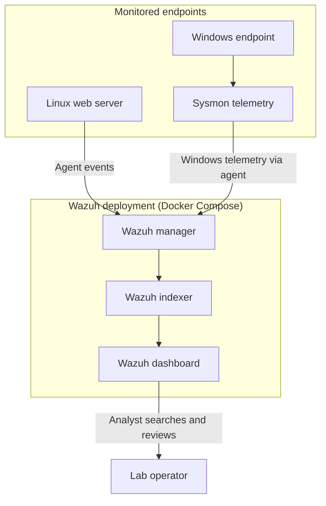

# Lab Architecture

This page records the high-level architecture reflected in the Week 1 report. Exact network addresses, host sizing, and all deployment settings were not provided in the report and are intentionally left unspecified.

## Logical topology

## Components

| Component | Purpose in this lab |
|---|---|
| Wazuh manager | Receives endpoint data and processes security events. |
| Wazuh indexer | Stores indexed event data for search and analysis. |
| Wazuh dashboard | Web interface used to review events. |
| Linux endpoint agent | Sends host activity from the Linux web server to Wazuh. |
| Windows endpoint agent | Sends Windows endpoint data to Wazuh. |
| Sysmon | Adds Windows process and other system telemetry that can be collected by the agent. |

The relationships above are a high-level interpretation of the report and standard Wazuh component roles. Confirm the exact service names, ports, integrations, and data paths against the Compose file used in your environment before treating this as a deployment diagram.

## Event-validation path

1. Generate an authorized test action on an endpoint.
2. The endpoint agent forwards collected telemetry to Wazuh.
3. Wazuh processes the incoming data and stores searchable event records.
4. The operator searches the dashboard and captures the relevant evidence.

## Details to add in a future revision

- Hostnames and roles (avoid publishing sensitive internal details).
- Docker network and published ports.
- Agent enrollment method and manager address.
- Sysmon configuration source and version.
- Relevant Wazuh rule IDs, timestamps, and event fields for each test.
- Any network boundaries or firewall rules.
